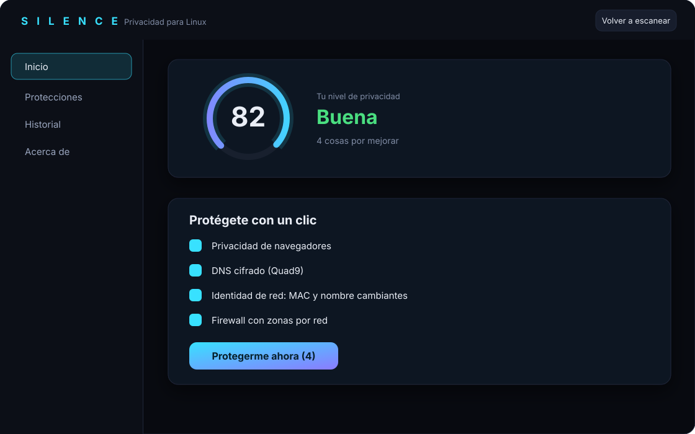

<p align="center">
  
</p>

<p align="center">
  <a href="https://vezzulab.github.io/Silence/"><b>Sitio web</b></a> ·
  <a href="#instalar">Instalar</a> ·
  <a href="#qué-hace">Qué hace</a> ·
  <a href="#límites-honestos">Límites</a>
</p>

**Silence** escanea tu sistema Linux, te dice **qué información comparte tu equipo**, lo explica sin jerga y lo arregla con tu permiso. Todo se puede deshacer.

Está pensado para cualquier usuario de Linux (Fedora, Ubuntu, Mint, Arch…), no solo para expertos: la pantalla de inicio es una lista de protecciones en lenguaje cotidiano y un botón, **«Protegerme ahora»**.

<p align="center">
  <br>
  <sub>Vista ilustrativa de la pantalla de inicio.</sub>
</p>

## Qué hace

| | |
|---|---|
| **Escanea** | servicios, puertos abiertos, DNS, firewall, cifrado de disco, SELinux/AppArmor, navegadores, apps Flatpak, telemetría de la distribución… (48 reglas) |
| **Explica** | para cada hallazgo: qué es, por qué afecta tu privacidad y **qué dejaría de funcionar** si lo cambias |
| **Comprueba el uso real** | antes de recomendar apagar algo mira si lo usas (impresoras, Bluetooth emparejado, SSH, dependencias activas) y no lo preselecciona si está en uso |
| **Aplica y revierte** | muestra los comandos exactos antes; cada cambio guarda el estado previo y se revierte con un clic (Historial) |
| **Se protege de sí mismo** | si algo de red falla tras aplicar, vuelve atrás solo a los 30 s si no confirmas |
| **Guardián** | un temporizador diario avisa si una actualización deshizo algo que aplicaste |
| **Aprende (en local)** | si revertes algo, no vuelve a insistirte. Nada sale de tu equipo |

## Protecciones

La pestaña *Protecciones* está organizada en seis secciones.

**Red**
- **Firewall**: mueve tus redes a una zona restrictiva (firewalld o ufw) y mantiene accesible lo que usas (SSH, KDE Connect, LocalSend). NetworkManager asigna la zona *por red guardada*, así que cambiar solo la «zona por defecto» no sirve; Silence lo hace bien.
- **DNS privado**: Quad9, Mullvad, o Mullvad con bloqueo de anuncios (ni Google ni Cloudflare), con DNS-over-TLS y validación del certificado por nombre.
- **Identidad de red**: MAC aleatoria en cada conexión y un nombre de equipo que **cambia en cada conexión** junto con la MAC (estilo celular `android-…` o PC con Windows `DESKTOP-…`), más huella DHCP y TCP/IP tipo Windows.
- **Apagar IPv6**: sysctl + perfiles de NetworkManager (que si no volvería a encenderlo), conservando `::1`.
- **Redes de confianza**: tus redes de casa en una zona permisiva y todas las demás como públicas.

**Navegadores**
- Firefox y Chromium/Chrome/Edge/Brave: sin telemetría, DuckDuckGo por defecto, uBlock Origin en Firefox. Niveles *Equilibrado* y *Máximo*, y una opción **ligero y rápido** (menos RAM y menos escrituras a disco).
- **Auditoría de extensiones**: qué extensiones tienes y cuáles piden «leer todas las páginas», cookies o historial.

**Archivos y rastros**
- **Limpiar metadatos**: quita ubicación, cámara y fechas de JPEG y PNG (y de PDF, documentos, audio y vídeo si tienes `mat2` o `exiftool`). Crea una copia; nunca toca el original.
- **Borrar rastros**: archivos recientes, miniaturas, historial de terminal y portapapeles, informes de fallos. Muestra el tamaño antes de borrar.
- **Modo pánico** en Inicio: borra los rastros y bloquea la pantalla en un clic.

**Aplicaciones**: recorta los permisos amplios de tus apps Flatpak (carpeta personal, dispositivos) y instala Tor Browser desde Flathub.

**Dispositivos**: bloqueo de la cámara web, silencio del micrófono con un clic y guía para USBGuard.

**Sistema**: endurecimiento del kernel (sysctl) y revisión de tus llaves SSH (permisos y llaves sin contraseña).

## Instalar

```bash
cargo build --release
sudo ./packaging/install.sh
systemctl --user enable --now silence-guardian.timer   # opcional: el Guardián
silence
```

Instala el binario en `/usr/local/bin` (propiedad de root), una política de polkit atada a esa ruta, el ícono y la entrada de menú.
Desinstalar: `sudo ./packaging/uninstall.sh` (antes, revierte desde *Historial* lo que quieras deshacer).

Requiere Rust (edición 2024) para compilar. Desarrollado y probado en Fedora con KDE; las funciones que dependen de NetworkManager, firewalld o Flatpak se desactivan solas si no están.

## Límites honestos

- **La huella DHCP no se puede ocultar del todo.** NetworkManager no deja cambiar el orden de las opciones DHCP, así que un router que identifique el sistema por ese orden puede seguir mostrando «Linux». Silence cambia lo que sí controla: MAC, nombre, clase de proveedor y pila TCP/IP.
- **KDE Connect** anuncia tu equipo en la red local; ciérralo en redes ajenas.
- Con MAC aleatoria, las redes con filtro por MAC o portales con tiempo limitado te tratarán como un equipo nuevo.
- Los cambios que tocan la red tienen un temporizador de seguridad que los revierte si no confirmas.

## Desarrollo

```bash
cargo test            # pruebas unitarias
cargo run             # abre la interfaz
cargo run -- scan     # escaneo desde la terminal (--json, --markdown)
cargo run -- rules    # catálogo de reglas
```

Las reglas viven en `rules/*.yaml` y se validan al cargar.
